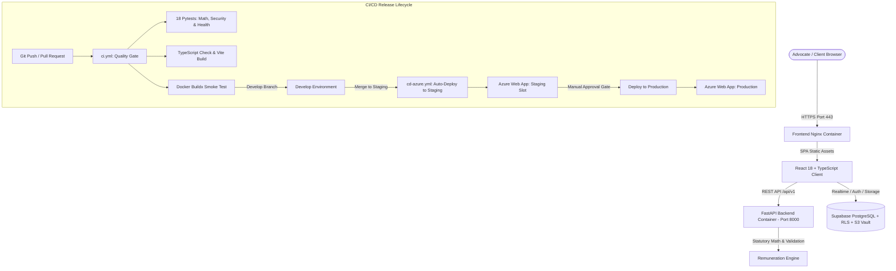

# ⚖️ Karani Law — Advocates Practice Management & Remuneration Platform
> **Nyagah B. Kithinji & Co. Advocates**
> Enterprise legal operations platform powered by **React 18 + TypeScript, Python 3.11 FastAPI, Supabase (PostgreSQL + RLS + S3 Vault), Production Docker Multi-Stage Containerization, GitHub Actions CI/CD, and Microsoft Azure Cloud Infrastructure**.

[](https://github.com/guyo-halake/nyagakithinji-Bill-of-Costs/actions/workflows/ci.yml)
[](https://github.com/guyo-halake/nyagakithinji-Bill-of-Costs/actions/workflows/cd-azure.yml)


---

## 🚀 Key Platform Capabilities

1. **Kenyan Advocates Remuneration Engine (`/backend/app/engine/remuneration_engine.py`)**:
   - Automated legal bill calculation under **Kenya Law LN 64/1962 (2014 Amendment Order)**.
   - **Schedule 6 (High Court, Court of Appeal, ELC, ELRC)** ad valorem scale calculations.
   - **Schedule 7 (Subordinate / Magistrate's Courts)** scale calculations.
   - **Getting-Up Fees** (33.33% / 1/3 of instruction fee floor).
   - Itemized folio work (Drawings @ Kshs 500/folio, Copying @ Kshs 50/folio, Court Attendances @ Kshs 2,500/hr, Formal Letters @ Kshs 500) + 16% VAT computation.
   - Validated against precedent taxation records (*Seyani Brothers v Greenhills* [KES 30.8M], *Dhanya Construction v Sunil Shah*).

2. **React + TypeScript Modern UI Shell (`/src`)**:
   - Bill of Costs interactive builder with real-time statutory breakdown.
   - Fee Notes vault, litigation matter management, and PDF/Excel generation.
   - Role-Based Access Control (Senior Partner, Associate Advocate, Finance Officer).

3. **Production Hardened Containerization**:
   - Multi-stage Docker builds separating build tools from runtime.
   - Unprivileged non-root user execution (`appuser:appgroup` UID 10001).
   - Integrated container health check probes on both frontend (Nginx) and backend (FastAPI).

---

## 🛠️ System Architecture & CI/CD Delivery



---

## 🌐 Enterprise Multi-Environment Pipeline

| Environment | Trigger | Target Azure Endpoint | Promotion Strategy |
| :--- | :--- | :--- | :--- |
| **Develop** | PR to `develop` / feature branch | Local Docker / Smoke runner | 18 Pytests + TypeScript check + Container smoke test |
| **Staging** | Push / merge to `staging` branch | `https://nyagahkithinji-advocates-staging.azurewebsites.net` | Automated ACR push & deployment with post-deploy health check |
| **Production** | Push / merge to `main` branch | `https://nyagahkithinji-advocates.azurewebsites.net` | Protected GitHub environment, manual review, zero downtime |

---

## ⚡ How to Run Locally

### Option 1: One-Command Docker Compose (Recommended)
Make sure Docker Desktop is running, then execute:
```bash
docker compose up --build
```
* **Frontend Web Application**: [http://localhost:3001](http://localhost:3001)
* **FastAPI Backend & Health Probe**: [http://localhost:8000/api/v1/health](http://localhost:8000/api/v1/health)
* **Interactive API Documentation (Swagger)**: [http://localhost:8000/docs](http://localhost:8000/docs)

### Option 2: Running Directly (Development Mode)
1. **Launch FastAPI Backend**:
   ```powershell
   cd backend
   pip install -r requirements.txt
   python -m uvicorn app.main:app --reload --port 8000
   ```
2. **Launch React Frontend**:
   ```powershell
   npm install
   npm run dev
   ```

---

## 🧪 Automated Testing

Run the full Python legal calculation and API test suite:
```powershell
cd backend
python -m pytest app/tests -v
```
* `test_remuneration.py`: Verifies Schedule 6, Schedule 7, litigation toggles, getting-up fees, and 1/6th rule.
* `test_security.py`: Verifies JWT authentication, bcrypt password hashing, and token expiration.
* `test_database_and_api.py`: Verifies health endpoints, statutory schedules, and fee notes integrity.
