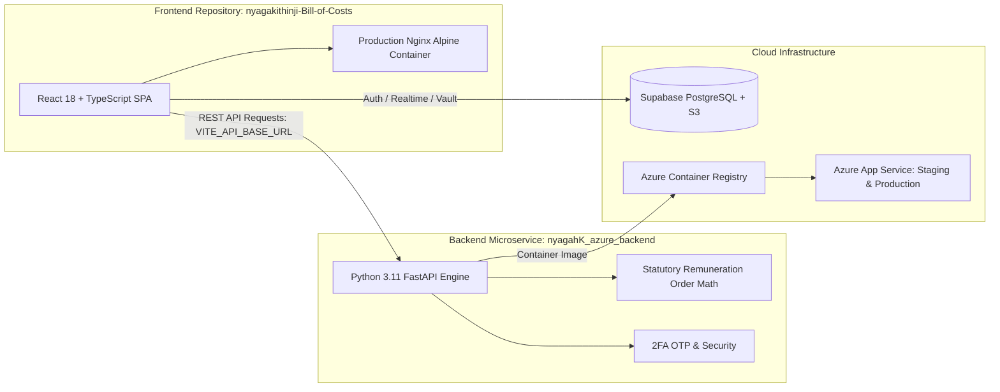

# ⚖️ Karani Law — Advocates Practice Management Frontend
> **Nyagah B. Kithinji & Co. Advocates**
> Modern legal operations frontend built on **React 18 + TypeScript, TailwindCSS, Vite, Supabase Realtime, and Alpine Nginx Containerization**.

> 🔗 **Decoupled Architecture Notice**:
> This repository houses the client-side single page application (SPA).
> The **Python 3.11 FastAPI statutory calculation engine, Docker containerization, and Azure CI/CD cloud deployment** are maintained in the dedicated repository:
> 👉 **[nyagahK_azure_backend](https://github.com/guyo-halake/nyagahK_azure_backend)**

[](https://github.com/guyo-halake/nyagakithinji-Bill-of-Costs/actions/workflows/ci.yml)


---

## 🏛️ System Microservice Architecture



---

## 🚀 Key Client Capabilities

1. **Advocates Remuneration Order Builder (`src/components/feenotes`)**:
   - Interactive Bill of Costs taxation builder with real-time statutory scale breakdowns.
   - Dynamic schedule toggles (Schedule 6 High Court, Schedule 7 Subordinate Courts, Conveyancing, Probate).
   - Instant calculation preview with automatic fallback to client-side rule evaluation.

2. **Real-Time Matters & Litigation Management (`src/components/matters`)**:
   - Case pipeline tracking active disputes, court schedules, claim values, and party records.
   - Authoritative precedent records (*Seyani Brothers v Greenhills* [KES 30.8M], *Dhanya Construction v Sunil Shah*).

3. **Multi-Role Access Control (RBAC)**:
   - Senior Partner, Associate Advocate, Finance Officer, and Legal Assistant views.
   - 2FA OTP verification for administrative password resets and privilege elevation.

---

## ⚡ Environment Configuration

Copy `.env.example` to `.env.local`:
```bash
cp .env.example .env.local
```

| Variable | Description | Default / Example |
| :--- | :--- | :--- |
| `VITE_SUPABASE_URL` | Supabase Project URL | `https://your-id.supabase.co` |
| `VITE_SUPABASE_ANON_KEY` | Supabase Anon Public Key | `eyJhbGciOi...` |
| `VITE_API_BASE_URL` | FastAPI Backend API Base URL | `http://localhost:8000` (Local) / `https://nyagahkithinji-advocates.azurewebsites.net` (Prod) |

---

## 🛠️ Running Locally

### Development Mode:
```bash
npm install
npm run dev
```
* Client launches on [http://localhost:3000](http://localhost:3000) with automatic hot-module reloading (HMR).

### Containerized Production Build:
```bash
docker compose up --build
```
* Optimized Nginx container serves production static assets on [http://localhost:3001](http://localhost:3001).

---

## 🧪 Verification & Typechecking

```bash
# Verify TypeScript integrity
npx tsc --noEmit

# Test production asset bundle compilation
npm run build
```
